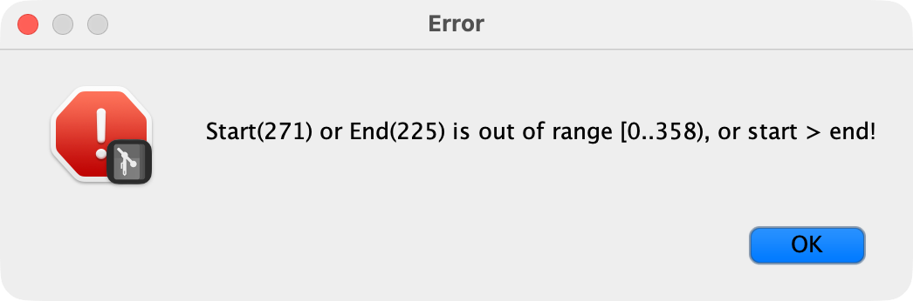

## TODO

> high priority

- edit notebook dialog, should be a screen on mobile devices (like settings on mobile vs desktop)
- when a notebook have active encryption, add possiblity to disable it again -> it would remove the .git, and just create a new local repo, and then force push to the remote to overwrite the encrypted bundles?

> medium priority

- when highlighting text in the codeblock, it crashed with (all code blocks scrolling and non-scrolling) not only code blocks, it does it even on normal text 
- add something like quick note, which it be deleted after the application exit (for some quick test notes)
- add note linking
- save the expanded folder to database (so that the file tree looks the same on app open)+ save all tabs that were opened
- make latex blocks work also in the middle of the block, not only on empty block
- add bottom bar - info button and character/word count (add some help to topAppBar - usage, shortcuts in the app,
  markdown cheatsheet, etc.)
- add ctrl+r replace (replace all/current)
- follow clean architecture and introduce UseCases instead of injecting repositories into *r*epositories
- run periodic git fetch to display if the notes are actually up to date (or just run it once on notebook open)
- in the settings as possibility to change the commit message
- add nucleus fs-watcher (or other fs watcher)
- fix pdf export -> dont export the compose page -> convert to html for proper text selection and reduced size
- make section collapsible, like in obsidian, eg. everything under h1 can be collased

> other ideas - lower priority

- add support for mermaid diagrams
- make file header like in obsidian - the file heading will show the file name changing the header will change the filename
- when there is a merge conflict, add preview on the conflicted files and content
- when note is opened and image is clicked from the sidebar, make the image appear on new tab
- share notes on mobile? like normal share button to quickshare, email ...
- in the file tree show which files are modified (based on the git status)
- when renaming image resource – refactor the notes to use the new image name?
- add some highlight cursor to the file tree so that i can be operated only with keyboard (f2 for renaming and ctrl+n
  for new file)
- make username and password optional for cloning when cloning public repo – then the sync would be disabled?
- add some overview of the opened note, it will show the headers, and you can jump to the specified header
